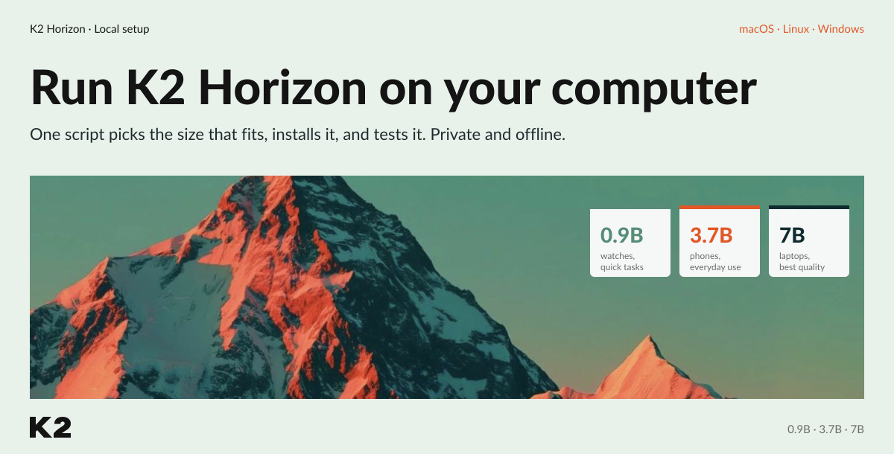
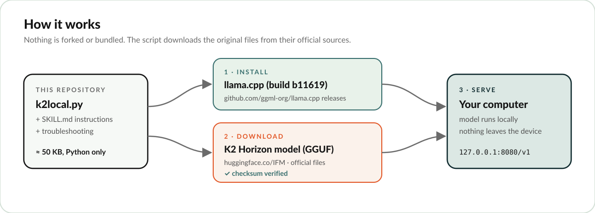
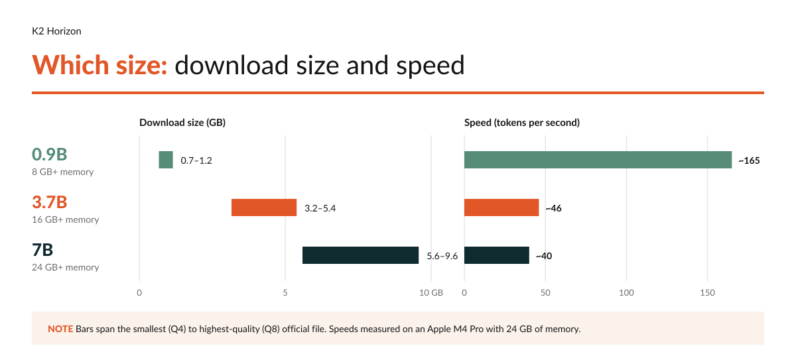
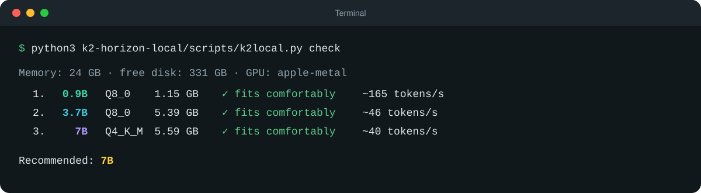
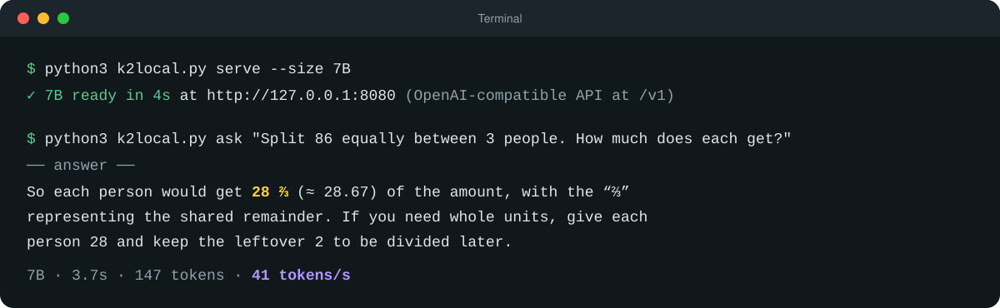

# Run K2 Horizon locally



Run [K2 Horizon](https://huggingface.co/IFM), the open models from MBZUAI's Institute of Foundation Models, privately on your own computer, in the size and format that fit your machine.

One script checks your computer, helps you pick between the **0.9B**, **3.7B** and **7B** models and between two formats, then installs, downloads, starts and tests it. Everything runs on your machine. After the download, nothing is sent anywhere.

- Works on **macOS, Linux and Windows**, and only needs Python 3.8+. No packages to install.
- Uses IFM's **official GGUF files** from Hugging Face, compressed or full quality, and runs them with [llama.cpp](https://github.com/ggml-org/llama.cpp).
- Picks the right file for your memory, so the model doesn't slow to a crawl.
- Resumes interrupted downloads and verifies every file against the official checksum.
- Gives you a local, OpenAI-compatible API at `http://127.0.0.1:8080/v1`.
- Is also packaged as a **skill** (`SKILL.md`), so an AI agent can do the whole setup for you.

## How it works



This repository contains only the setup script and its instructions. Nothing is forked or bundled. When you run it, the script downloads:

1. **llama.cpp**, the open-source program that runs the model, from its official GitHub releases.
2. **The K2 Horizon model** in GGUF format, from IFM's official Hugging Face page, and checks it against IFM's published checksum.

It then starts the model on your computer, opens a chat with it in a terminal window, and gives you a local web chat at `http://127.0.0.1:8080`.

That's the default, compressed GGUF format: one file made for laptops and phones. The 7B model is 18 GB in full precision, while compressed GGUF is 5.6–9.6 GB and runs on any Mac, Windows or Linux machine. If you want full precision, see [Which format?](#which-format) below.

## Which size should I use?



| Size | Made for | Download | Speed* | Good at | Watch out |
|---|---|---|---|---|---|
| **0.9B** | Watches, glasses, quick commands | 0.7–1.2 GB | ~165 tokens/s | Instant replies, reminders, simple tool calls | Makes mistakes on reasoning |
| **3.7B** | Phones, everyday laptop use | 3.2–5.4 GB | ~46 tokens/s | Summaries, document questions, tool calls, code fixes | Translations can be partly wrong |
| **7B** | Laptops, developer workstations | 5.6–9.6 GB | ~40 tokens/s | Best overall: passed every task in our tests | Slowest of the three |

\*Measured on an Apple M4 Pro Mac with 24 GB of memory. A token is about ¾ of a word. Computers without a GPU are several times slower.

Not sure? Run `check` (below). It shows which sizes fit your computer and recommends one:

| Your memory | Recommended |
|---|---|
| 8 GB | 0.9B |
| 16 GB | 3.7B |
| 24 GB or more | 7B |

## Which format?

Both are IFM's official GGUF files. Compressed GGUF is the default and the right choice for most people.

| Format | `--format` | Download (0.9B / 3.7B / 7B) | Speed* | In one sentence |
|---|---|---|---|---|
| **GGUF, compressed** | `gguf` (default) | 0.7–1.2 / 3.2–5.4 / 5.6–9.6 GB | ~105 tokens/s | A compressed single file run by llama.cpp: the smallest download and the fastest replies on any computer, with a small loss in quality. |
| **GGUF, full quality (BF16)** | `gguf-bf16` | 2.2 / 10.1 / 18.0 GB | ~74 tokens/s | The full-precision weights in one GGUF file for llama.cpp: original quality with nothing extra to install, but about twice the size and ~30% slower. |

\*0.9B on an Apple M1 Pro with 16 GB of memory, so the numbers compare the formats, not the sizes above.

Full quality needs much more memory: with 16 GB, only 0.9B fits in BF16. `check` shows what fits for each format. To use it, add `--format gguf-bf16` to `download` and `serve`:

```bash
python3 k2-horizon-local/scripts/k2local.py download --size 0.9B --format gguf-bf16
python3 k2-horizon-local/scripts/k2local.py serve --size 0.9B --format gguf-bf16
```

## Quick start

Download this repository (**Code → Download ZIP**, or `git clone`), open a terminal in it, and run:

```bash
python3 k2-horizon-local/scripts/k2local.py check                  # see what fits your computer
python3 k2-horizon-local/scripts/k2local.py install                # get llama.cpp for your system
python3 k2-horizon-local/scripts/k2local.py download --size 3.7B   # pick 0.9B, 3.7B or 7B
python3 k2-horizon-local/scripts/k2local.py serve --size 3.7B      # start it
python3 k2-horizon-local/scripts/k2local.py ask "Split 86 equally between 3 people. How much does each get?"
python3 k2-horizon-local/scripts/k2local.py chat                   # chat with it in the terminal
```

On Windows, use `py` instead of `python3`. While it's running, you can also chat in your browser at `http://127.0.0.1:8080`.

Here's `check` on a 24 GB Mac:



And here's the 7B model starting and answering:



When you're done, stop it with `… k2local.py stop`. Next time, just run `serve`. Install and download only happen once.

## All commands

| Command | What it does |
|---|---|
| `check` | Shows your memory, disk and GPU, how well each size and format fits, and a recommendation |
| `install` | Downloads the latest llama.cpp for your OS and GPU (Metal, CUDA, Vulkan or CPU), falling back to the tested build b11619 if needed. Use `--build tested` for b11619, `--force` to update, or `--backend cpu` to force the CPU build. |
| `download --size 0.9B\|3.7B\|7B` | Downloads and verifies a model. Add `--format gguf-bf16` for full quality, or `--quant Q4_K_M\|Q5_K_M\|Q6_K\|Q8_0` to choose the compressed file yourself |
| `serve [--size …] [--format …]` | Starts the model in the background at `http://127.0.0.1:8080`, which is also a web chat (GGUF formats) |
| `ask "…"` | Asks a question. Add `--effort low\|medium\|high` to control how much it thinks, and `--show-thinking` to see its reasoning |
| `chat` | Chats with the model in the terminal. `--window` opens the chat in a new terminal window. Inside it: `/new`, `/effort low\|medium\|high`, `/exit` |
| `status` | Shows what's downloaded and what's running |
| `stop` | Stops the model and frees the memory |

Files are stored in `~/k2-horizon-local`. Change that with `--dir` or the `K2_DIR` environment variable. To remove everything, delete that folder.

You can download several sizes and formats and switch between them: `stop`, then `serve --size 7B` (add `--format …` for another format).

## Use it from your own code

The server speaks the OpenAI chat API, so most libraries and apps work with it:

```python
from openai import OpenAI
client = OpenAI(base_url="http://127.0.0.1:8080/v1", api_key="not-needed")
reply = client.chat.completions.create(
    model="k2-horizon",
    messages=[{"role": "user", "content": "Hello!"}],
    extra_body={"chat_template_kwargs": {"reasoning_effort": "low"}},
)
```

The answer is in `reply.choices[0].message.content` and the model's thinking in `reasoning_content`. Tool calls come back in the standard `tool_calls` field. See [`using-from-code.md`](k2-horizon-local/references/using-from-code.md) for tool calling, and for one known case to handle: 3.7B at medium effort returns an empty answer.

## Let an AI agent set it up for you

All you need is one file: [**`SKILL.md`**](k2-horizon-local/SKILL.md). It has the step-by-step instructions, and the agent fetches the setup script from this repository by itself. It checks your computer, shows you the size and format options and lets you choose, then installs, starts and tests the model.

- **Agents that support skills:** put `SKILL.md` in a folder named `k2-horizon-local` inside the agent's skills folder, then ask something like *"Set up K2 Horizon on my laptop."*
- **Any other agent that can run commands:** give it `SKILL.md` (attach the file, or paste the link) and ask it to *"follow this to set up K2 Horizon on my computer."*

If you downloaded the whole repository, the agent uses the script that's already here instead.

## Something went wrong?

See [`troubleshooting.md`](k2-horizon-local/references/troubleshooting.md). It covers empty answers, slow output, stalled downloads, macOS blocking the program, the server quitting on start, a busy port, and GitHub's rate limit. `status` and the `server.log` file in your storage folder are the best places to start.

## Tested on

- **macOS, Apple Silicon (M4 Pro, 24 GB):** all three sizes in compressed GGUF, end to end.
- **macOS, Apple Silicon (M1 Pro, 16 GB):** 0.9B in both formats, end to end.
- **Linux and Windows:** supported by the script, which picks the right llama.cpp build, but not yet tested on real hardware. If the auto-selected GPU build fails, run `install --backend cpu --force`.

Answers vary a little between runs. In our tests, the smallest model (0.9B) sometimes got simple reasoning wrong. Use 3.7B or 7B when accuracy matters.

## Community

Questions, feedback, or want to share what you built? Join the IFM Discord: [ifm.ai/discord](https://ifm.ai/discord)

## Credits

- **K2 Horizon** models by the [Institute of Foundation Models (IFM), MBZUAI](https://huggingface.co/IFM), released under Apache 2.0.
- **[llama.cpp](https://github.com/ggml-org/llama.cpp)** runs the models (MIT license).
